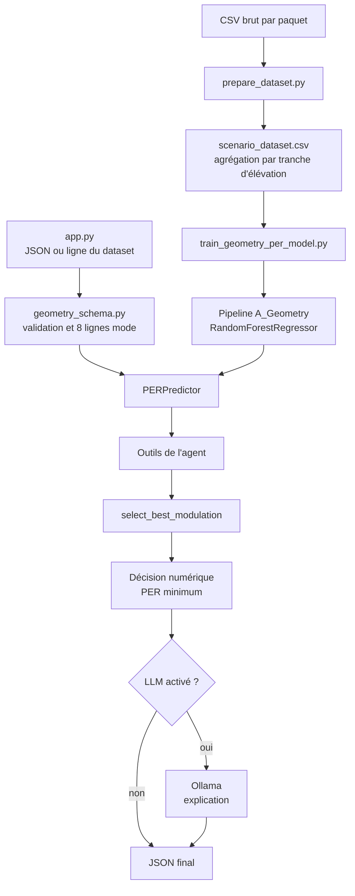

# Agent de sélection de modulation pour un réseau IoT satellite NTN

## Résumé en cinq lignes

- Le projet compare huit modes radio : LR-FHSS `DR8`/`DR9` et LoRa `SF7` à `SF12`.
- Il estime le taux d'erreur paquet (PER) pour chaque mode à partir de la géométrie agrégée d'un scénario et du nombre `N` de paquets/appareils indiqué dans les données.
- Un modèle scikit-learn produit les PER prédits ; du code Python choisit ensuite le minimum.
- Ollama ne prend pas la décision : il peut seulement produire une explication textuelle de la décision calculée.
- Sur le dataset agrégé présent dans les résultats, `DR8` est sélectionné pour `N=10000` et `N=50000`, et `DR9` pour `N=100000` ([`results/agent_dataset_audit.json`](results/agent_dataset_audit.json)).

> Le dépôt permet de vérifier le pipeline logiciel et les résultats enregistrés. Le simulateur radio, les trajectoires TLE et une validation terrain ne sont pas présents dans les fichiers examinés.

## 1. Contexte et problématique

Le projet traite un scénario de réseau IoT satellite NTN. Cette lecture vient du nom du projet, de la documentation existante et des variables de trajectoire, de puissance, de Doppler et de visibilité présentes dans le code et les données.

Les modes étudiés sont :

| Famille visible dans le code | Modes |
|---|---|
| LR-FHSS | `DR8`, `DR9` |
| LoRa | `SF7`, `SF8`, `SF9`, `SF10`, `SF11`, `SF12` |

Le critère numérique utilisé par le projet est le **PER** (*Packet Error Rate*). Le dataset le calcule par `per = 1 - n_success / n_packets` dans [`scripts/Database/prepare_dataset.py`](scripts/Database/prepare_dataset.py). Le sélecteur cherche le mode dont le PER prédit est le plus petit.

Les entrées géométriques du modèle sont les huit variables de [`src/prediction/geometry_schema.py`](src/prediction/geometry_schema.py) :

- `elevation_mean_deg` ;
- `distance_mean_km` ;
- `orbital_velocity_mean_ms` ;
- `relative_velocity_mean_ms` ;
- `relative_velocity_signed_mean_ms` ;
- `doppler_shift_mean_hz` ;
- `doppler_rate_mean_hz_s` ;
- `doppler_peak_rate_mean_hz_s`.

Le Doppler, la vitesse, la distance et l'élévation décrivent des conditions radio et géométriques susceptibles d'influencer la réception. Dans les résultats disponibles, les six premières variables sont identiques entre modes pour une même condition ; les deux variables de taux Doppler diffèrent entre modes ([`results/agent_dataset_audit.json`](results/agent_dataset_audit.json)). Le nombre `N` est aussi une variable du modèle et sépare les conditions observées.

## 2. Architecture globale



Le plan de simulation est une branche séparée : [`scripts/plan_simulations.py`](scripts/plan_simulations.py) crée un plan et [`data/simulation_plan/manifest.json`](data/simulation_plan/manifest.json) indique explicitement `plan_only_not_simulated`. Ce plan n'est donc pas une entrée nécessaire de l'application actuelle.

## 3. Structure du dépôt

```text
AI_AGENT_IOT/
├── app.py                         # CLI principale de démonstration de l'agent
├── README.md                      # Documentation existante
├── README2.md                     # Support de présentation orale
├── requirements.txt               # Dépendances applicatives
├── requirements-analysis.txt      # requirements.txt + matplotlib
├── run_project.bat                # Installation Windows, vérifications et menu
├── data/
│   ├── raw/                       # CSV brut, ignoré par Git
│   ├── processed/                 # Dataset agrégé, ignoré par Git
│   └── simulation_plan/           # Plan et manifeste, sans résultats simulés
├── models/per_model/              # Chemin du modèle Joblib de production
├── src/
│   ├── agent/                     # Agent, prompt et outils LangChain
│   ├── decision/                  # Sélection du mode par PER minimum
│   ├── prediction/                # Schéma, validation et prédiction PER
│   └── utils/                     # Configuration et appel Ollama
├── scripts/
│   ├── Database/                  # Préparation et inspection des données
│   ├── ML/                        # Entraînement, benchmarks et évaluations
│   ├── analysis/                  # Audits, statistiques et figures
│   └── plan_simulations.py        # Génération d'un plan expérimental
├── tests/                         # Tests unitaires et tests d'intégration locale
└── results/                       # Artefacts d'analyse et métriques enregistrés
```

### Fichiers importants

- [`app.py`](app.py) lit un scénario, instancie `PERPredictor` et `ModulationAgent`, puis affiche un JSON.
- [`src/agent/modulation_agent.py`](src/agent/modulation_agent.py) orchestre la décision et l'explication optionnelle.
- [`src/agent/tools.py`](src/agent/tools.py) expose `predict_per` et `select_best_modulation` avec validation Pydantic.
- [`src/agent/prompts.py`](src/agent/prompts.py) contient le prompt et la limitation scientifique transmise au LLM.
- [`src/decision/modulation_selector.py`](src/decision/modulation_selector.py) choisit le minimum parmi les huit PER.
- [`src/prediction/geometry_schema.py`](src/prediction/geometry_schema.py) définit les modes, features et validations.
- [`src/prediction/per_predictor.py`](src/prediction/per_predictor.py) charge et contrôle le pipeline Joblib.
- [`src/utils/ollama_client.py`](src/utils/ollama_client.py) vérifie Ollama et son modèle.
- [`scripts/Database/prepare_dataset.py`](scripts/Database/prepare_dataset.py) transforme le brut en dataset d'apprentissage.
- [`scripts/ML/train_geometry_per_model.py`](scripts/ML/train_geometry_per_model.py) entraîne le modèle `A_Geometry`.
- [`scripts/analysis/audit_raw_dataset.py`](scripts/analysis/audit_raw_dataset.py) réagrège le brut pour contrôle ; il n'entraîne pas le modèle.
- [`scripts/analysis/audit_agent_dataset.py`](scripts/analysis/audit_agent_dataset.py) produit l'audit descriptif du dataset agrégé.
- [`tests/`](tests/) vérifie les contrats de l'agent, de la géométrie, de l'étude CSV, de la CLI et du plan.
- [`results/`](results/) contient des résultats déjà produits ; ils ne constituent pas tous le modèle de production.

## 4. Les données

### CSV brut

Le fichier attendu est :

```text
data/raw/packet_level_dataset_with_geometry_doppler_rp002_1_0_5.csv
```

Le rapport d'audit indique `6 400 000` lignes et `4 412 740 330` octets ([`results/csv_raw_audit/report.json`](results/csv_raw_audit/report.json)). Le script [`run_project.bat`](run_project.bat) indique comme origine une archive Google Drive dont l'identifiant est `15GaVg...2Tgdlq`.

Le code de préparation demande notamment les colonnes `scheme`, `mode`, `N`, `environment`, `replication`, `scenario_seed`, les variables d'élévation, distance, vitesse, pertes, puissance, SNR, Doppler, collisions, pertes de visibilité et `success` ([`scripts/Database/prepare_dataset.py`](scripts/Database/prepare_dataset.py)). La présence exacte de l'en-tête physique du très gros CSV est **à confirmer** directement dans le fichier brut.

### Dataset agrégé

[`scripts/Database/prepare_dataset.py`](scripts/Database/prepare_dataset.py) :

1. lit le brut par blocs de `100000` lignes ;
2. crée une tranche `elevation_bin` de 5 degrés ;
3. regroupe par schéma, mode, `N`, environnement, réplication, seed et tranche ;
4. additionne les comptes et grandeurs ;
5. calcule les moyennes et les taux de perte ;
6. écrit `data/processed/scenario_dataset.csv`.

Les résultats enregistrés décrivent `2040` lignes, `255` conditions, `15` groupes seed/réplication, l'environnement `urban` et `N` égal à `10000`, `50000` ou `100000` ([`results/agent_dataset_audit.json`](results/agent_dataset_audit.json)). Les huit modes sont présents pour chaque condition. Le nombre de paquets par ligne va de `181` à `19894` selon le même rapport.

Une réagrégation à 1 degré est aussi disponible dans les résultats : elle produit `10200` lignes, mais elle n'est pas directement comparable au dataset à 5 degrés ([`results/csv_raw_audit_1deg/report.json`](results/csv_raw_audit_1deg/report.json)).

### Fichiers ignorés par Git

Le [`.gitignore`](.gitignore) ignore :

- `.env` ;
- `data/raw/*` ;
- `data/processed/*.csv` et `*.parquet` ;
- `models/**/*.joblib` ;
- les environnements virtuels et fichiers Python temporaires.

C'est pourquoi le brut, le dataset traité, le modèle Joblib et la configuration locale peuvent manquer après un clone. Le fichier [` .env.ollama.example`](.env.ollama.example) est un exemple suivi par Git, pas le `.env` réellement chargé.

## 5. Fonctionnement pas à pas

### Étape 1 : préparer les données

Fonctionnement principal dans [`scripts/Database/prepare_dataset.py`](scripts/Database/prepare_dataset.py). Le résultat de chaque groupe contient les moyennes géométriques et radio, les comptes de paquets, `per`, ainsi que les taux de collision, perte Doppler et perte de visibilité.

### Étape 2 : entraîner le prédicteur PER

[`train_model`](scripts/ML/train_geometry_per_model.py) :

- valide les colonnes et les huit modes ;
- encode `mode` avec `OneHotEncoder` ;
- standardise les variables numériques ;
- entraîne un `RandomForestRegressor` de 400 arbres, avec `min_samples_leaf=2`, `random_state=42` et `n_jobs=-1` ;
- sauvegarde le pipeline en `models/per_model/per_predictor_A_Geometry.joblib`.

Le script précise qu'il s'agit d'un entraînement complet et ne calcule pas de métrique de validation à cette étape.

### Étape 3 : valider un scénario

[`make_frame`](src/prediction/geometry_schema.py) crée une ligne par mode. [`validate_frame`](src/prediction/geometry_schema.py) vérifie les noms, les types, les valeurs finies, `N`, l'élévation et certaines bornes physiques.

### Étape 4 : prédire les huit PER

[`PERPredictor.predict_modes`](src/prediction/per_predictor.py) charge le pipeline, contrôle sa compatibilité `A_Geometry`, détecte une entrée hors domaine d'entraînement et prédit le PER des huit modes. Par défaut, une entrée hors domaine provoque une erreur.

### Étape 5 : choisir le mode

[`select_best_modulation`](src/decision/modulation_selector.py) calcule :

```python
best_mode = min(MODES, key=predictions.__getitem__)
```

Il renvoie le mode choisi, son PER, tous les PER et `tied_modes`. En cas d'égalité exacte, l'ordre déclaré dans [`MODES`](src/prediction/geometry_schema.py) est utilisé ; `DR8` vient avant `DR9`, puis les modes SF. Ce comportement est testé dans [`tests/test_geometry_agent.py`](tests/test_geometry_agent.py).

## 6. Rôle du LLM avec Ollama

Le LLM reçoit la question, le scénario, la décision numérique et la limitation scientifique ([`src/agent/modulation_agent.py`](src/agent/modulation_agent.py)). Il rédige une explication ; il ne recalcule pas les PER et ne remplace pas les champs de `decision`.

Garde-fous présents dans le code :

- `--no-llm` désactive l'appel et renvoie `llm_status: "disabled"` ;
- `--require-llm` provoque un code de sortie `2` si le statut n'est pas `generated` ;
- une panne Ollama ou une réponse vide conserve la décision et renvoie `llm_status: "unavailable"` ;
- le texte est marqué `explanation_status: "unverified_text"` ;
- la décision est calculée avant l'appel au LLM et les tests vérifient que le texte du LLM ne peut pas l'écraser.

La configuration facultative est documentée dans [`.env.ollama.example`](.env.ollama.example) : `OLLAMA_BASE_URL`, `OLLAMA_MODEL`, `OLLAMA_TIMEOUT`. La disponibilité réelle d'Ollama et du modèle local est à confirmer sur la machine d'exécution.

## 7. Entrées et sorties de `app.py`

Principales options déclarées dans [`app.py`](app.py) :

| Option | Rôle |
|---|---|
| `--model` | Chemin du pipeline Joblib ; défaut : modèle `A_Geometry` |
| `--dataset` | CSV utilisé avec `--row` |
| `--row` | Index de ligne du CSV, par défaut `0` |
| `--scenario` | JSON contenant `geometry` et `N` |
| `--N` | Remplace la valeur `N` du scénario ou du CSV |
| `--question` | Question envoyée au LLM |
| `--llm-model` | Nom d'un modèle Ollama installé |
| `--ollama-url` | URL Ollama |
| `--timeout` | Délai Ollama |
| `--no-llm` | Exécution sans LLM |
| `--require-llm` | Code `2` si l'explication n'est pas générée |
| `--interactive` | Questions successives sur le même scénario |

Exécution sans dépendre d'Ollama :

```powershell
python .\app.py --no-llm --N 10000
```

Exemple de forme de sortie JSON, basée sur les clés construites dans [`ModulationAgent.recommend`](src/agent/modulation_agent.py) :

```json
{
  "scenario": {
    "geometry": {
      "elevation_mean_deg": 45.0,
      "distance_mean_km": 800.0
    },
    "N": 10000
  },
  "decision": {
    "best_mode": "DR8",
    "predicted_per": 0.12,
    "per_by_mode": {"DR8": 0.12, "DR9": 0.18},
    "tied_modes": ["DR8"]
  },
  "limitation": "...texte défini dans src/agent/prompts.py...",
  "llm_status": "disabled",
  "explanation": null,
  "llm_error": null,
  "explanation_status": "not_requested"
}
```

Les nombres ci-dessus servent uniquement à illustrer la structure ; le code calcule les valeurs réelles. En sortie de `app.py`, `input_source` est aussi ajouté au JSON.

## 8. Résultats et évaluation disponibles

Les chiffres ci-dessous viennent des fichiers présents dans `results/`. Ils décrivent les artefacts enregistrés, pas une nouvelle exécution de ce README.

| Analyse | Résultat disponible | Source |
|---|---|---|
| Audit du dataset | `2040` lignes, `255` conditions ; `DR8` optimal pour `N=10000` et `50000`, `DR9` pour `100000` ; une égalité optimale | [`results/agent_dataset_audit.json`](results/agent_dataset_audit.json) |
| Statistiques PER | Moyennes : DR8 `0.43405`, DR9 `0.45704`, SF7 `0.92388`, SF8 `0.96646`, SF9 `0.99582`, SF10 `0.99988`, SF11 `0.999997`, SF12 `1.0` | [`results/per_statistics_by_mode.csv`](results/per_statistics_by_mode.csv) |
| Sélection OOF | Matrice : `170` décisions DR8 correctes et `85` DR9 correctes, soit `255/255` dans cette matrice | [`results/modulation_confusion_matrix.csv`](results/modulation_confusion_matrix.csv) |
| Évaluation CSV à 5° | `RF_mode_N` : MAE `0.0077535`, R² `0.9957868`, précision `1.0` ; `RF_common_geometry` : MAE `0.0045000`, R² `0.9986637`, précision `1.0` | [`results/csv_agent_evaluation/report.json`](results/csv_agent_evaluation/report.json) |
| Référence toujours DR8 | Précision `0.6667`, regret moyen `0.0120561`, regret maximal `0.0589407` | [`results/csv_agent_evaluation/report.json`](results/csv_agent_evaluation/report.json) |
| Évaluation à 1° | `RF_A_Geometry_diagnostic` : MAE `0.0095612`, R² `0.9938855`, précision `0.9584314` | [`results/csv_agent_evaluation_1deg/report.json`](results/csv_agent_evaluation_1deg/report.json) |
| Comparaison de features | Meilleur MAE moyen : `C_Full_Channel`, `0.0044310` ; `A_Geometry`, `0.0044585` | [`results/feature_sets_comparison.csv`](results/feature_sets_comparison.csv) |
| Comparaison GroupKFold | Random Forest meilleur MAE moyen : `0.0044309` ; ExtraTrees : `0.0045350` | [`results/model_comparison_cv.csv`](results/model_comparison_cv.csv) |
| Benchmark simple | ExtraTrees meilleur MAE `0.0042871` ; HistGradientBoosting meilleur R² `0.9988037` et latence `0.02779 ms/sample` | [`results/model_comparison.csv`](results/model_comparison.csv) |
| Corrélations | Corrélation PER/SNR `-0.75438`, PER/collision rate `0.78480`, PER/N `0.33942` | [`results/per_correlations.csv`](results/per_correlations.csv) |

Les benchmarks ne doivent pas être confondus avec le modèle de production : le modèle chargé par défaut est le pipeline `A_Geometry` de [`train_geometry_per_model.py`](scripts/ML/train_geometry_per_model.py).

## 9. Limites et validité

Les limites explicites du code et des rapports sont les suivantes :

- l'agrégation principale par tranche de 5 degrés masque la variabilité interne d'un passage ;
- la réagrégation à 1 degré donne des résultats différents et moins directement comparables ;
- la règle « choisir selon `N` » suffit sur les observations présentes, mais cela ne prouve pas une adaptation géométrique ;
- les différences de géométrie entre modes doivent encore être expliquées par le simulateur ;
- le modèle de production est entraîné sur tout le dataset et son script ne calcule pas de validation ;
- les audits décrivent le CSV, mais n'auditent pas le CSV brut ni le code du simulateur au-delà des colonnes lues ;
- les résultats disponibles ne démontrent pas une généralisation à des géométries inédites ;
- le plan de simulation ne contient aucun résultat (`plan_only_not_simulated`) ;
- la sélection optimise le PER, pas le débit, l'énergie ou une métrique applicative ;
- les données TLE, le simulateur externe, les paramètres radio complets et une mesure terrain sont à confirmer, car ils ne sont pas présents dans le dépôt.

## 10. Tests

| Fichier | Couverture principale |
|---|---|
| [`tests/test_agent_cli.py`](tests/test_agent_cli.py) | CLI, mode sans LLM, valeurs `N` invalides et exigence d'un LLM disponible |
| [`tests/test_geometry_agent.py`](tests/test_geometry_agent.py) | Entraînement temporaire, prédiction, validation, domaine, compatibilité du pipeline et égalités |
| [`tests/test_modulation_agent.py`](tests/test_modulation_agent.py) | Outils, prompts, garde-fous et échecs Ollama/LLM |
| [`tests/test_csv_study.py`](tests/test_csv_study.py) | Agrégation, comparaison des réagrégations, validations et GroupKFold |
| [`tests/test_simulation_preparation.py`](tests/test_simulation_preparation.py) | Taille/reproductibilité du plan, groupes test et audits descriptifs |

Commande depuis la racine :

```powershell
python -m unittest discover -s tests -p "test_*.py" -v
```

Le fait que des rapports existent dans `results/` ne prouve pas que la suite a été exécutée dans l'environnement Windows actuel ; ce point est à confirmer.

## 11. Installation et exécution

### Démarrage Windows

Depuis la racine, [`run_project.bat`](run_project.bat) :

- vérifie Python et crée/réutilise `.venv` ;
- installe `requirements.txt` ;
- vérifie les CSV et peut télécharger une archive si des fichiers manquent ;
- vérifie Ollama et le modèle configuré ;
- propose un menu pour l'agent, les tests et le mode interactif.

Le script ne doit pas être interprété comme une preuve que la préparation et l'entraînement sont exécutés automatiquement : les branches visibles du menu lancent `app.py` ou les tests. Pour reconstruire explicitement le dataset puis le modèle :

```powershell
$env:DATASET_PATH = (Resolve-Path ".\data\raw\packet_level_dataset_with_geometry_doppler_rp002_1_0_5.csv").Path
python .\scripts\Database\prepare_dataset.py
python .\scripts\ML\train_geometry_per_model.py
python .\app.py --no-llm --N 10000
```

### Avec Ollama

Le modèle demandé doit être installé dans Ollama. La commande documentée par le projet est par exemple :

```powershell
ollama pull llama3.2:3b
python .\app.py --llm-model llama3.2:3b --N 10000 --require-llm --question "Explique simplement pourquoi ce mode est recommandé."
```

Le nom exact du modèle disponible localement et l'état du serveur sont à confirmer sur la machine.

### Études enregistrées

Les commandes d'audit utilisent des dossiers de sortie distincts pour éviter d'écraser les résultats existants :

```powershell
python .\scripts\analysis\audit_agent_dataset.py
python .\scripts\analysis\audit_raw_dataset.py --output-dir results/csv_raw_audit_test
python .\scripts\ML\evaluate_csv_agent.py --output-dir results/csv_agent_evaluation_test
```

## 12. Pistes d'amélioration dérivées des limites

- Évaluer sur des géométries réellement inédites, et réserver les groupes de test avant tout entraînement ou réglage.
- Documenter ou intégrer le simulateur, ses paramètres radio, ses trajectoires et la définition de la vitesse Doppler.
- Comparer systématiquement les agrégations à 5° et à 1° pour quantifier l'effet de la tranche.
- Ajouter des métriques applicatives au-delà du PER si elles sont disponibles : cette extension est une piste, pas une fonctionnalité actuelle.
- Conserver séparément un modèle de production et des modèles de benchmark, avec une validation clairement associée à chacun.
- Ajouter une vérification reproductible de l'environnement Windows et des versions de dépendances ayant produit les résultats.

## 13. Questions probables à l'oral

**Pourquoi utiliser un agent si la décision est calculée en Python ?**  
Parce que Python réalise la décision déterministe et que l'agent fournit une interface d'outils et une explication optionnelle ; le LLM n'est pas l'autorité numérique.

**Quel est le critère de sélection ?**  
Le mode dont le PER prédit est minimal parmi les huit modes.

**Que signifie `N` ?**  
Dans ce dépôt, `N` est une entrée entière positive du scénario et une valeur présente dans le dataset ; sa signification métier exacte au-delà de cet usage est à confirmer.

**Pourquoi le Doppler apparaît-il dans les features ?**  
Le schéma contient le décalage et les taux Doppler, et l'audit montre que les deux taux Doppler varient entre modes. L'effet physique complet doit être expliqué par le simulateur, absent du dépôt.

**Pourquoi ne pas laisser Ollama choisir le mode ?**  
Le code calcule d'abord `decision`; Ollama reçoit cette décision pour la commenter. Les tests vérifient que son texte ne peut pas modifier les champs numériques.

**Les résultats prouvent-ils une adaptation à la géométrie ?**  
Non. L'audit indique que `N` suffit sur les observations disponibles, ce qui ne prouve pas une généralisation ou une adaptation géométrique.

**Pourquoi les résultats à 1° sont-ils différents ?**  
Une tranche plus fine conserve moins de paquets par groupe et change l'agrégation ; le rapport 1° doit être comparé au rapport 5° avec cette limite en tête.

**Le modèle de production est-il validé indépendamment ?**  
Le script de production l'entraîne sur tout le dataset sans métrique de validation dans cette étape. Les évaluations séparées présentes dans `results/` documentent des études, mais leur correspondance exacte avec le modèle déployé est à confirmer.

## 14. Points à vérifier par l'auteur

- Vérifier l'en-tête et l'origine exacte du CSV brut ; les colonnes listées ici sont celles demandées par le code, pas une lecture directe de l'en-tête du fichier de plusieurs gigaoctets.
- Vérifier que `data/processed/scenario_dataset.csv` a bien été reconstruit avec la version actuelle de `prepare_dataset.py`.
- Vérifier la présence, le chemin et la version du modèle `models/per_model/per_predictor_A_Geometry.joblib`.
- Vérifier le contenu du `.env` local et ses valeurs `DATASET_PATH`, `OLLAMA_MODEL`, `OLLAMA_BASE_URL` et `OLLAMA_TIMEOUT`.
- Vérifier la version Python, les versions installées et la reproductibilité des résultats dans `.venv`.
- Exécuter la suite de tests dans l'environnement Windows actuel et conserver sa sortie.
- Vérifier la disponibilité réelle d'Ollama et de `llama3.2:3b`.
- Identifier le simulateur externe, ses paramètres radio et ses trajectoires TLE, non présents dans le dépôt.
- Confirmer la signification métier exacte de `N` et la façon dont les labels `success` sont produits.
- Confirmer si les chemins Unix présents dans certains rapports correspondent bien à la production des résultats actuels.
